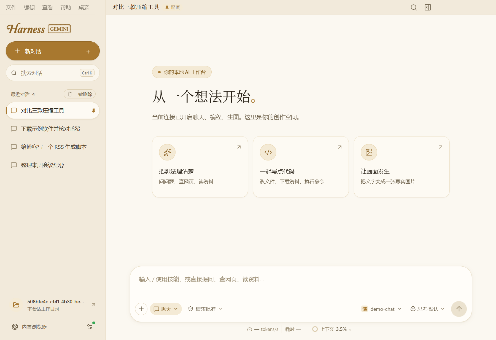
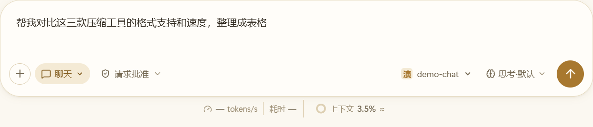
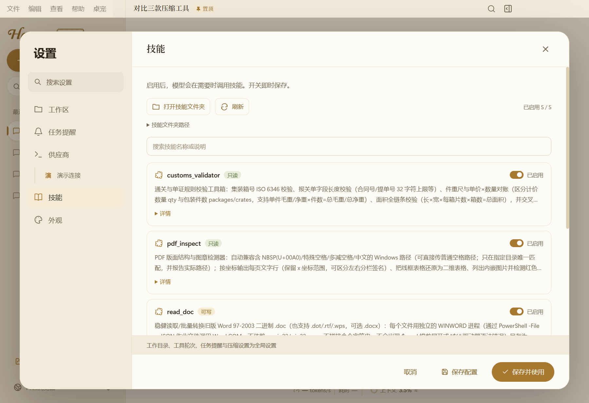
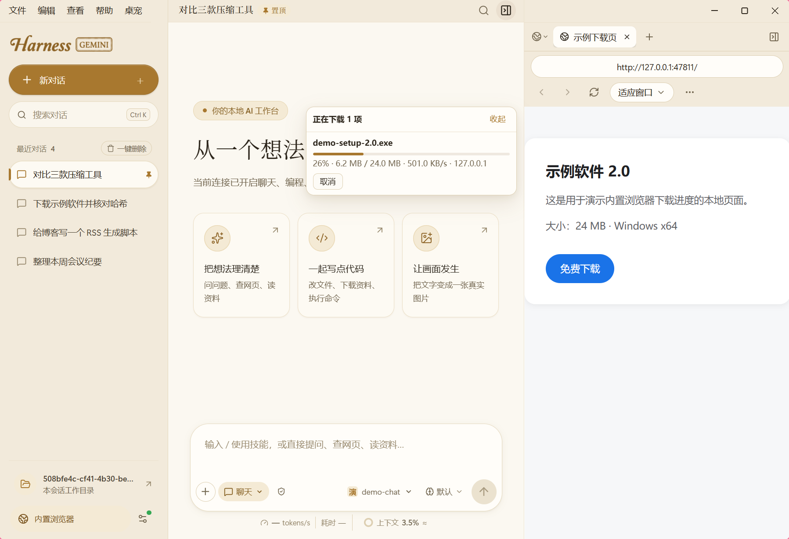

# Harness Gemini

Windows 桌面 AI 工作台，在一个窗口中聊天、编程、生图和浏览网页。

**[下载 1.5.8 安装包](https://github.com/gylidianh/harness-gemini/releases/download/v1.5.8/Harness-Gemini-1.5.8-win-x64.exe)** · **[浏览源码](app/)** · [版本说明](CHANGELOG.md) · [使用指南](docs/usage.md) · [开发说明](docs/development.md) · [常见问题](docs/faq.md)

## 1.5.8 更新

- 修复 JPEG 结束标记后带附加字节时被拒收的问题；保留原图及大小限制。
- 产物文件条目新增右键“复制路径”，支持完整路径、中文空格及键盘操作。
- 保留 1.5.7 的代理分类与会话删除清理修复。
- [1.5.8 发布说明](docs/releases/1.5.8.md)；Release 提供安装包、源码 ZIP 和 SHA256 校验文件。

## 功能

| 功能 | 说明 |
| --- | --- |
| 模型连接 | 支持 OpenAI Chat Completions、Anthropic Messages、OpenAI Responses 协议；可保存和切换多个连接 |
| 聊天、编程、生图 | 为不同模式配置模型，在输入框工具栏中切换 |
| 模型与思考等级 | 从工具栏选择模型；推理参数是否生效取决于模型和接口支持 |
| 内置浏览器 | 多标签页、网页读取与交互、文件下载与进度显示，也可打开本地页面 |
| 技能与子代理 | 管理外置技能，查看任务清单和子任务进度 |
| 界面与上下文 | 五种主题、Markdown 与公式、附件、上下文占用和压缩设置 |

## 开始使用

1. 下载并安装 Windows x64 版本，无需另外安装 Node.js。
2. 打开左下角 **设置 → 供应商**，填写接口地址、协议和模型；需要鉴权的服务再填写 API Key。
3. 点击 **保存并使用**，在输入框中选择模式、模型、权限和思考等级。
4. 输入消息开始使用。右侧工作空间默认收起，可通过顶部面板按钮展开。

已有安装的用户，请先退出旧程序，再运行新安装包覆盖升级。设置、会话和工作目录继续保留。

详细步骤、文件校验和数据位置见 [使用指南](docs/usage.md)。

## 界面

输入工具栏集中显示附件、模式、权限、模型、思考等级和发送按钮；设置使用左侧分类、右侧内容的布局。

查看输入工具栏

查看设置与技能管理

查看内置浏览器下载进度

以上截图拍摄于 1.4.4，来自独立演示环境，连接和模型名称为示例，不包含真实密钥、聊天记录或用户文件。

## 数据与权限

- 设置、会话和产物保存在本机。模型请求发送到你配置的服务；联网工具会访问对应网站。
- 桌面版使用 Windows 系统密钥保护加密保存 API Key，已保存的密钥默认以掩码显示。
- 工具操作受所选权限模式和审批结果控制。编程命令以当前 Windows 用户权限执行，会话目录不是系统沙箱。
- 发布附件只包含程序与运行依赖，不携带维护者的本机配置、会话、日志或工作文件。

更多说明见 [数据位置与权限](docs/usage.md#数据位置与权限)。

## 下载、文档与反馈

本仓库维护 Windows 安装包、可用源码和使用文档。

- [当前版本与全部下载](https://github.com/gylidianh/harness-gemini/releases/latest)
- [更新记录](CHANGELOG.md)
- [使用指南](docs/usage.md)
- [源码范围、运行与打包](docs/development.md)
- [常见问题](docs/faq.md)
- [报告问题](https://github.com/gylidianh/harness-gemini/issues/new/choose)
- [参与维护](CONTRIBUTING.md)

## 源码范围

[app/](app/) 包含与已发布 1.5.8 对应的 [桌面端](app/desktop/)、[服务端](app/server/)、[共享模块](app/shared/) 和 [新增 UI 模块与前端产物](app/dist/)，可在 GitHub 上直接点开查看。`SOURCE-MANIFEST.json` 记录这些文件在发布包中的校验值。

基础界面的原始 React 工程目前不在仓库中，不能从这里重新构建该前端 bundle；现有前端产物可直接运行并随桌面程序打包。详见 [开发说明](docs/development.md)。

## 贡献者

1. [@gylidianh](https://github.com/gylidianh)
2. [@nexou9527](https://github.com/nexou9527)

## 致谢

项目使用 Electron、React、Express、KaTeX、react-markdown、lucide 和 undici 等组件。内置浏览器界面、上下文统计及附件功能部分改编自 [ZCode](https://github.com/zai-org/ZCode)。部分供应商图标来自 [LobeHub Icons](https://github.com/lobehub/lobe-icons) 和供应商站点。完整第三方许可与来源说明随程序附带，见 [第三方声明](app/THIRD-PARTY-NOTICES.md)、[第三方许可](app/third-party/) 和图标目录中的许可文件。
