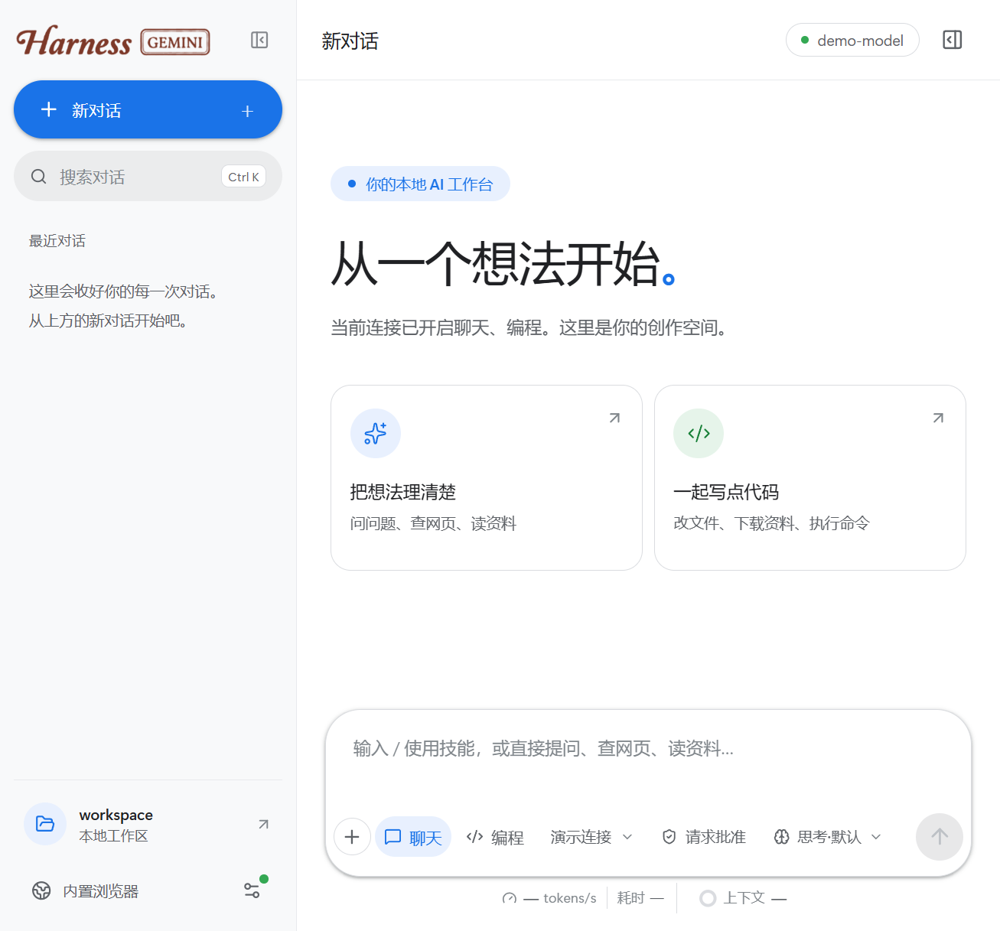
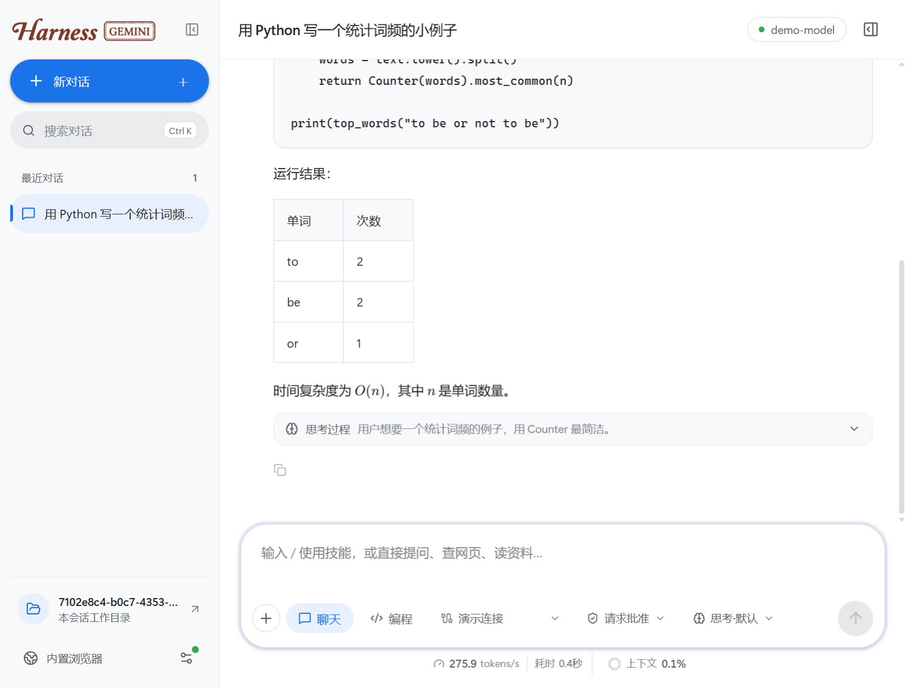

# Harness Gemini

**你的本地 AI 工作台：聊天、生图、编程、浏览网页，一个窗口全搞定。**

[下载](#-下载) · [功能](#-功能特性) · [快速开始](#-快速开始) · [数据与隐私](#-数据与隐私) · [常见问题](#-常见问题)

  
  

## ✨ 功能特性

### 🔌 接入任意模型
- 支持三种接口协议：**OpenAI Chat Completions**（`/chat/completions`）、**Anthropic Messages**（`/v1/messages`）、**OpenAI Responses**（`/responses`）。
- 可以保存多个连接，每个连接分别填写聊天、编程、生图模型，在输入框里随时切换。
- 每个连接可以单独设置**推理等级**（低 / 中 / 高 / 模型默认）。模型不支持时自动不发送该参数，不会导致请求失败。

### 💬 三种工作模式
| 模式 | 能做什么 |
| --- | --- |
| **聊天** | 连续对话、流式回复、搜索网页、读取资料，只用只读工具 |
| **编程** | 读写文件、下载资料、执行命令，在独立的会话目录中完成任务 |
| **生图** | 调用生图模型，图片自动保存到本机，可放大、下载、一键复制 |

### 🌐 内置浏览器
- 多标签页浏览器，可以一边聊天一边看网页，也能打开本地 `file://` 页面。
- 模型可以直接**打开、读取、点击、输入、滚动**网页，需要 JavaScript 渲染的页面也能读到。
- 模型可以**截屏**并真正"看到"页面的排版、图表和颜色。
- 不会替你登录，也不会绕过验证码。

### 🤖 智能体能力
- **任务清单**：多步骤任务会显示进度清单，做完的步骤自动划掉。
- **子代理**：把独立的子任务并行交给子代理处理，权限和停止操作随主任务一起生效。
- **外置技能**：把常用脚本（Python / JS / PowerShell）做成技能，模型会自己判断何时调用。自带 PDF 读取技能。
- **上下文管理**：实时显示上下文占用，接近上限时自动压缩较早的历史。

### 🎨 细节体验
- Markdown、代码块、表格、**LaTeX 数学公式**自动排版。
- 思考过程默认折叠，显示 tokens/s 与耗时。
- 5 套界面皮肤：Gemini 白、Gemini 暗、Claude 橘、鎏金黑、象牙金，切换立即生效。
- 支持粘贴、拖拽附件，任务完成后弹出提醒并播放提示音。

### 🔐 权限可控
| 权限模式 | 说明 |
| --- | --- |
| **请求批准** | 每次写文件、执行命令前都要你确认 |
| **帮我批准** | 自动放行搜索网页、读取网页、新建文件；覆盖文件、执行命令仍需确认 |
| **完全访问权限** | 自动读写文件、运行命令并联网，适合你信任的任务 |

## 📦 下载

前往 [Releases](https://github.com/gylidianh/harness-gemini/releases/latest) 下载最新版本：

| 文件 | 系统 | 说明 |
| --- | --- | --- |
| `Harness-Gemini-1.0.0-win-x64.exe` | Windows 10 / 11（64 位） | 便携版，下载后双击即可运行，无需安装 |

> 无需安装 Node.js 或其他运行环境，程序已自带。

## 🚀 快速开始

1. 下载 `Harness-Gemini-1.0.0-win-x64.exe` 并双击运行。
2. 点击左下角「内置浏览器」右侧的 **设置** 按钮，新建一个模型连接：
   - 选择接口协议（Chat Completions / Anthropic Messages / Responses）
   - 填写 **API 地址**（通常以 `/v1` 结尾）和 **API Key**
   - 点击 **读取此连接的模型**，或手动填写聊天、编程、生图模型（至少填一个）
3. 点击 **保存并使用**，回到主界面开始对话。
4. 在输入框下方切换 **聊天 / 编程** 模式和权限；输入 `/` 可以调用技能或子代理。

## 🔒 数据与隐私

- **完全本地运行**：程序只在本机 `127.0.0.1` 启动服务，对话直接发往你自己配置的模型接口，不经过任何第三方服务器。
- **数据保存在你的电脑上**：

  | 内容 | 位置 |
  | --- | --- |
  | 设置、对话、图片、错误日志 | `%APPDATA%\Local Harness\data` |
  | 会话工作目录 | `文档\Local Harness\workspace` |

- **API Key 加密保存**：使用 Windows 系统密钥保护（DPAPI）加密后写入磁盘。
- **发布包不含任何个人数据**：exe 里只有程序本身，没有任何配置、密钥或对话记录。

## ❓ 常见问题

<b>打开时 Windows 提示"已保护你的电脑"怎么办？</b>

程序没有购买代码签名证书，所以 SmartScreen 会提示。点击 **更多信息 → 仍要运行** 即可。也可以先核对文件的 SHA-256 校验值（见 Release 页面）。

<b>设置页里 API Key 是明文显示的？</b>

是的，1.0.0 起设置页会直接显示已保存的 Key，方便查看和修改。磁盘上仍是加密保存，其他网页无法读取。**截图或录屏分享设置页时请注意遮挡。** 清空输入框再保存会删除该连接的 Key。

<b>支持哪些模型服务？</b>

任何兼容 OpenAI Chat Completions、Anthropic Messages 或 OpenAI Responses 接口的服务都可以，包括官方 API、各类中转服务，以及本地部署的模型（如 Ollama、LM Studio 等提供的兼容接口）。

<b>编程模式执行命令安全吗？</b>

命令以当前 Windows 用户的权限在本机执行。会话目录只是默认起点，不是系统沙箱。建议默认使用 **请求批准**，执行前先查看工具卡里的命令。

<b>怎么升级到新版本？卸载要删什么？</b>

- **升级**：关闭旧版，运行新版 exe 即可，设置和对话会自动保留。
- **卸载**：删除 exe；如需清除数据，再删除上面"数据与隐私"表格里的两个文件夹。

<b>出错了在哪里看原因？</b>

失败原因会保存在对应消息上，重启后仍可查看和复制；同时会写入数据目录下的 `logs/errors.log`（菜单 **文件 → 打开错误日志**）。日志不含对话内容，密钥会自动隐藏。

## 📝 更新日志

见 [Releases](https://github.com/gylidianh/harness-gemini/releases)。

## 🙏 致谢

- [Electron](https://www.electronjs.org/)、[React](https://react.dev/)、[Vite](https://vite.dev/)、[Express](https://expressjs.com/)
- [KaTeX](https://katex.org/)、[react-markdown](https://github.com/remarkjs/react-markdown)、[lucide](https://lucide.dev/)、[undici](https://github.com/nodejs/undici)
- 内置浏览器界面、上下文统计与附件功能部分改编自 [ZCode](https://github.com/zai-org/ZCode)（Apache License 2.0）

第三方组件的完整许可证随程序附带，见安装包内的 `THIRD-PARTY-NOTICES.md` 和 `third-party/` 目录。

---

如果这个项目对你有帮助，欢迎点一个 ⭐ Star

