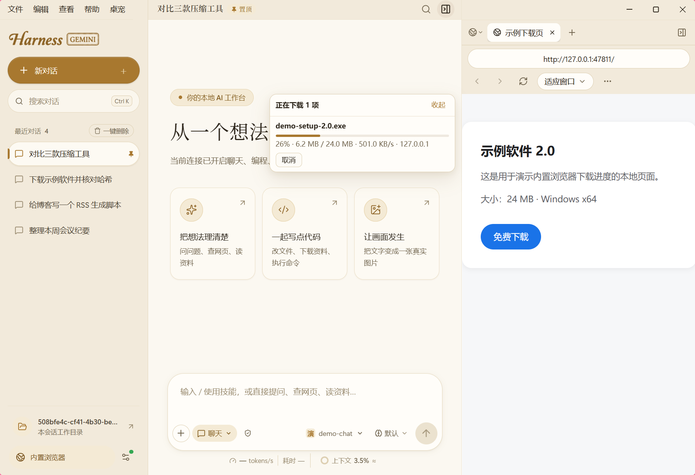

# 使用指南

适用于 Harness Gemini 1.5.7。返回 [项目首页](../README.md) · [常见问题](faq.md)

## 安装与升级

在 [Release 页面](https://github.com/gylidianh/harness-gemini/releases/latest) 下载 Windows 10 / 11 x64 安装包。程序自带运行环境，无需另外安装 Node.js。

首次安装：双击安装包，按向导选择安装位置，完成后启动 Harness Gemini。

覆盖升级：先退出正在运行的旧程序，再运行新版安装包。不要用删除数据目录的方式升级；已有设置、会话和工作目录会保留。

### 校验安装包

1.5.7 文件名：`Harness-Gemini-1.5.7-win-x64.exe`。

在文件所在目录打开 PowerShell，执行：

```powershell
Get-FileHash .\Harness-Gemini-1.5.7-win-x64.exe -Algorithm SHA256
```

1.5.7 的 SHA-256 为：

```text
B7E9E306280F24752CA86A789CE5BA14D4900076950E4191F08FCBD18DE7C8C0
```

其他版本请使用对应 Release 附带的 `SHA256SUMS.txt`，不要混用不同版本的校验值。

## 配置供应商

点击左下角设置按钮，进入 **供应商** 分类。可以编辑现有连接，也可以添加新供应商。

| 设置项 | 填写方式 |
| --- | --- |
| 配置名称 | 自己容易辨认的连接名称 |
| API 地址 | 服务商提供的接口地址，按其说明填写 |
| API 协议 | 选择 Chat Completions、Anthropic Messages 或 Responses |
| API Key | 服务需要鉴权时填写；已保存的值默认显示为掩码 |
| 聊天、编程、生图模型 | 分别填写该模式使用的模型 ID；至少配置一个模式 |
| 上下文窗口 | 按模型与服务的实际限制设置，不确定时保持默认 |

可使用 **读取此连接的模型** 获取列表，也可以手动输入服务商给出的模型 ID。

点击 **保存配置** 保存修改；点击 **保存并使用** 保存后启用所选连接。界面上的地址、模型名称只是配置，是否可用取决于对应服务。

## 输入工具栏


从左到右分别为附件、工作模式、操作权限、模型选择、思考等级和发送按钮。

- **附件**：可选择、粘贴或拖入文件。
- **模式**：在已配置的聊天、编程、生图模式之间切换。
- **权限**：选择请求批准、帮我批准或完全访问权限。
- **模型**：选择连接与当前模式使用的模型。
- **思考等级**：可选模型默认、低、中、高；实际发送的参数取决于模型和协议支持。
- **发送 / 停止**：发送消息，或停止正在进行的任务。

已开始的回复继续使用启动时的模型；切换后的配置用于下一条消息。任务进行中，部分操作可能暂不可用。

输入框下方显示模型请求耗时、输出速度与上下文占用。上下文统计可能包含估算值，具体以界面提示为准。

## 设置分类

| 分类 | 内容 |
| --- | --- |
| 工作区 | 工作目录根、工具调用轮次、上下文压缩 |
| 任务提醒 | 提示音、系统通知及试听 |
| 供应商 | 模型连接、接口协议、密钥和模型 |
| 技能 | 搜索技能、查看详情、刷新列表、启用或停用 |
| 外观 | Gemini 白、Gemini 暗、Claude 橘、鎏金黑、象牙金 |

技能开关即时保存。新增或修改技能后可在技能页刷新。部分技能可能依赖 Python、PowerShell 或其他工具，具体见技能说明。

## 工作空间与浏览器

右侧工作空间每次启动默认收起，点击顶部面板按钮展开。面板包含图片产物、子代理和工作区内容；也可以切换到内置浏览器。

左下角的工作目录入口可查看当前工作区。新会话默认在工作目录根下的 `sessions` 子目录中独立工作，实际路径以界面显示为准。

## 内置浏览器下载

在内置浏览器中点击下载链接，文件会直接保存到系统“下载”文件夹，不弹保存对话框；重名时自动加 `(1)`、`(2)`，不覆盖已有文件。

下载开始后，浏览器页面左侧会出现下载面板，显示进度、大小、速度和状态，可以取消下载或打开文件所在文件夹。最多同时下载 6 个文件。



## 数据位置与权限

| 内容 | 默认位置 |
| --- | --- |
| 设置、会话、图片产物与日志 | `%APPDATA%\Local Harness\data` |
| 工作目录根 | Windows“文档”中的 `Local Harness\workspace`，可在设置中更改 |

可通过顶部 **文件 → 打开数据目录 / 打开工作目录** 查看实际位置。备份时请退出程序，并同时备份数据目录与需要保留的工作文件。

桌面版使用 Windows 系统密钥保护加密保存密钥；复制数据到另一台电脑后，可能需要重新填写密钥。模型服务、网页访问和下载会按请求内容联网，本地存储不等于离线推理。

| 权限模式 | 主要行为 |
| --- | --- |
| 请求批准 | 写入文件、执行命令等操作需要确认 |
| 帮我批准 | 自动处理部分读取、联网和工作区内新建操作；覆盖文件、执行命令等仍可能要求确认 |
| 完全访问权限 | 自动执行允许的读写、命令与联网操作，具体仍受工具和服务限制 |

编程命令以当前 Windows 用户权限执行，会话工作目录不是操作系统沙箱。

## 卸载

通过 Windows **设置 → 应用 → 已安装的应用** 卸载 Harness Gemini。程序文件与用户数据是不同位置；如果还需要清除历史数据，请先确认备份，再处理上表中的目录。
